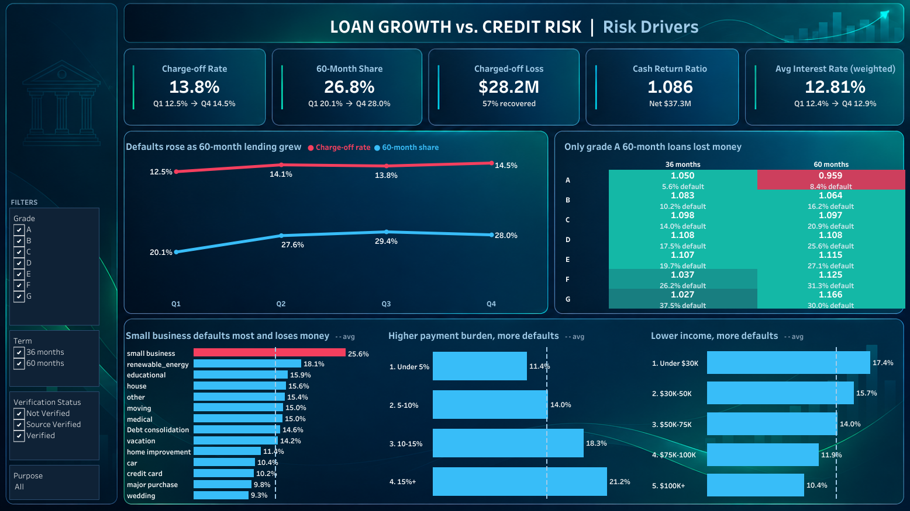
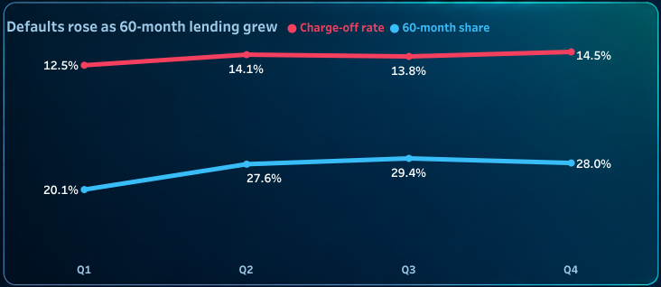
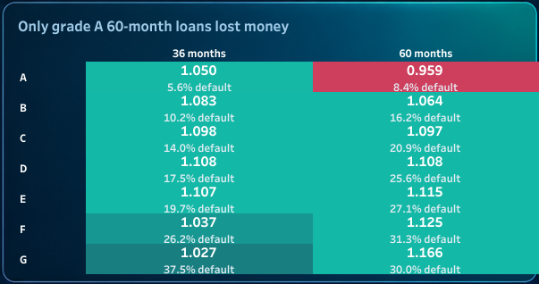
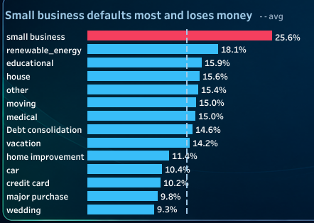

# Loan Growth vs. Credit Risk

> A lender more than doubled its monthly lending in one year, and its loans got worse. The share that went bad rose from 12.5% to 14.5%. The cause wasn't riskier borrowers. It was more 5-year loans, priced almost the same as 3-year loans for the same kind of borrower.

Live dashboard: [Tableau Public](https://public.tableau.com/app/profile/sahil.dadhwal7348/viz/LoanGrowthvsCreditRisk/Summary) | Built with SQL Server and Tableau



## 1. Background and Overview

In 2021 this lender went from lending $25.0M a month to $54.0M a month. That's more than double in one year.

When a lender grows that fast, the usual worry is that it's approving people it shouldn't. So the question I wanted to answer was simple. Did growing this fast mean making worse loans?

I started with a regular reporting dashboard. Once I saw that lending had doubled, I added a Risk Drivers page to answer that question. The final dashboard has 4 pages: Summary, Segments, Risk Drivers and Loan Details.

## 2. Data Structure Overview

The data is 38,576 personal loans issued in 2021, $435.8M in total. Each row is one loan, with 24 columns covering the loan (amount, length, interest rate, purpose), the borrower (income, job, state) and what happened to it (loan status, how much was paid back). Each loan also has a grade from A (safest) to G (riskiest) that the lender gave it when it was approved.

A few terms I use throughout:

- **Bad loan (charged off):** the borrower stopped paying and the lender wrote it off.
- **Charge-off rate:** the share of loans that went bad.
- **Cash return ratio:** money paid back divided by money lent. Under 1.0 means the lender lost money.

How I built it:

- **SQL Server:** I loaded the data, checked it, and calculated every number in SQL first. The default import settings would have broken 725 large loans, so I fixed those. I checked for duplicates and missing values, and kept 1,438 loans with no job title instead of dropping them. Good thing, because those loans went bad more often (18.5% vs. 13.6%).
- **Tableau:** I built the 4 pages, added calculated fields for charge-off rate and cash return ratio, and set up filters (grade, loan length, income verification, purpose) that work across every page. Every number on the dashboard matches SQL.

## 3. Executive Summary

- **Yes, loans got worse as the lender grew.** The share of new loans that went bad went from 12.5% in Q1 to 14.5% in Q4.
- **But it wasn't riskier borrowers. It was more 5-year loans.** They go bad twice as often as 3-year loans (22.3% vs. 10.7%). Even for borrowers with the same grade (A to D), they go bad about 1.5 times as often, and the lender charged less than 1 point more in interest for them.
- **Two areas actually lost money:** grade A borrowers on 5-year loans, and small business loans.
- **Overall, the lender still came out ahead on cash.** Borrowers paid back $37.3M more than was lent, even after $28.2M was lost on bad loans. That's before the lender's own costs.

## 4. Insights Deep Dive

### Defaults went up as 5-year loans grew



5-year loans went from 20% of new loans in Q1 to 28% in Q4, and the bad-loan rate moved up with them. Riskier borrowers didn't go up. Loans to grades D to G actually dropped from 25% to 23%. The shift to longer loans explains about half of the rise, while the average interest rate barely moved (11.7% to 12.1%).

One thing to keep in mind: newer loans have had less time to go bad, so the real increase is probably bigger than this.

### The safest borrowers were undercharged on 5-year loans



Each box shows how much came back for every $1 lent. Every grade and loan length made money except one: grade A on 5-year loans. Those borrowers paid almost the same rate as grade A on 3-year loans (7.5% vs. 7.3%) but went bad more often (8.4% vs. 5.6%). The lender got back 96 cents on the dollar and lost about $174K on 415 loans.

### Small business loans lost money



About 1 in 4 small business loans went bad (25.6%), the highest of any loan purpose. The lender put in $24.12M and got back $23.81M. No other purpose lost money.

### Other warning signs

| What I looked at | Safest group | Riskiest group |
| :--- | :--- | :--- |
| Monthly payment as % of income | Under 5%: 11.4% went bad | Over 15%: 21.2% went bad |
| Annual income | $100K+: 10.4% went bad | Under $30K: 17.4% went bad |

Something I expected to matter but didn't: how long someone has been at their job. Every group landed between 12% and 15%.

## 5. Recommendations

1. **Charge more for 5-year loans, starting with grade A.** For the same grade, they go bad more often but cost almost the same as 3-year loans.
2. **Keep 5-year loans to around 20% of new lending,** where they were at the start of the year.
3. **Tighten small business lending** with stricter approval, higher rates or smaller loans. It's the only loan type losing money.
4. **Track the bad-loan rate every month, not just how much is being lent.** The volume numbers looked great while loan quality was slipping.

## Project Files

```
loan-growth-vs-credit-risk/
├── README.md
├── sql/
│   ├── 01_staging_table.sql         # table setup and import fixes
│   ├── 02_data_quality_checks.sql   # duplicates, missing values, ranges
│   ├── 03_kpi_queries.sql           # totals and monthly changes
│   └── 04_risk_analysis.sql         # charge-off rate and cash return by segment
├── tableau/
│   └── Loan Growth vs Credit Risk.twbx
└── images/                          # dashboard screenshots
```
